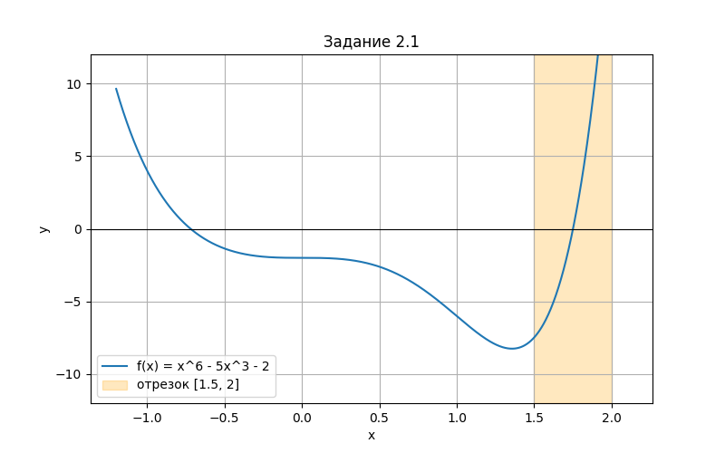
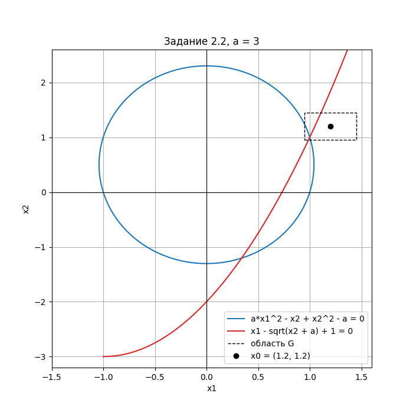

# Лабораторная работа №2. Методы решения нелинейных уравнений и систем нелинейных уравнений

Вариант 27

## Запуск

Из корня репозитория:

```
cmake -S . -B build -G Ninja -DCMAKE_CXX_COMPILER=g++
cmake --build build
./build/bin/lab2.exe
```

Пункты меню:

| Пункт | Задание | Файл с данными |
|---|---|---|
| 1 | 2.1 Нелинейное уравнение | `data/lab2/input_2_1.txt` |
| 2 | 2.2 Система нелинейных уравнений | `data/lab2/input_2_2.txt` |

Графики для выбора начального приближения строит скрипт `plots.py` (нужны numpy и matplotlib):

```
python Lab2/plots.py
```

Картинки сохраняются в папку `Lab2/images`.

## Задание 2.1. Решение нелинейного уравнения

### Условие
Реализовать методы простой итерации и Ньютона решения нелинейных уравнений в виде программ,
задавая в качестве входных данных точность вычислений. С использованием разработанного
программного обеспечения найти положительный корень нелинейного уравнения (начальное
приближение определить графически). Проанализировать зависимость погрешности вычислений
от количества итераций.

### Вариант 27
$$
x^6 - 5x^3 - 2 = 0
$$

### Начальное приближение


У уравнения два корня: отрицательный около -0.72 и положительный между 1.5 и 2.
Берем отрезок $[1.5, 2]$: $f(1.5) = -7.48 < 0$, $f(2) = 22 > 0$.

**Метод Ньютона.** $f'(x) = 6x^5 - 15x^2$ и $f''(x) = 30x^4 - 30x$ на отрезке положительные.
Начальное приближение берем там, где $f(x_0) f''(x_0) > 0$ (условие 2.3), это $x_0 = 2$.

**Метод простой итерации.** Из $x^6 = 5x^3 + 2$ получаем
$$
x = \varphi(x) = (5x^3 + 2)^{1/6}, \qquad \varphi'(x) = 2.5x^2 (5x^3 + 2)^{-5/6}
$$
На $[1.5, 2]$ значения $\varphi(x)$ лежат от 1.632 до 1.864, то есть не выходят за отрезок,
и $q = \max|\varphi'(x)| \approx 0.486 < 1$. Условия теоремы 2.3 выполнены.
Начинаем тоже с $x_0 = 2$, чтобы методы было удобно сравнивать.

Условия окончания:
- простая итерация: $\frac{q}{1-q} |x^{(k)} - x^{(k-1)}| \le \varepsilon$;
- Ньютон: $|x^{(k)} - x^{(k-1)}| \le \varepsilon$.

### Входные данные
`input_2_1.txt`: точность eps, концы отрезка a и b.
```
0.001
1.5 2
```

### Что выводит программа
1. Отрезок и проверку, что на его концах f(x) разных знаков.
2. Проверку условий сходимости для обоих методов и выбор x0.
3. Таблицы итераций: x(k), f(x(k)), оценка погрешности eps(k) и настоящая погрешность |x(k) - x*|.
4. Найденные корни и точный корень для проверки. Точный корень находится заменой $t = x^3$:
   $t^2 - 5t - 2 = 0$, $t = \frac{5 + \sqrt{33}}{2}$, $x^* = t^{1/3} = 1.751403644$.
5. Количество итераций при разных eps.

### Результат
При eps = 0.001 метод простой итерации дал x = 1.75193 за 8 итераций,
метод Ньютона x = 1.7514 за 4 итерации.

Погрешность $|x^{(k)} - x^*|$ по итерациям:

| k | 0 | 1 | 2 | 3 | 4 | 5 | 6 | 7 | 8 |
|---|---|---|---|---|---|---|---|---|---|
| Простая итерация | 0.249 | 0.113 | 0.052 | 0.0241 | 0.0112 | 0.0052 | 0.00242 | 0.00113 | 0.000524 |
| Ньютон | 0.249 | 0.0819 | 0.0121 | 0.000306 | 2.04e-07 | | | | |

| eps | Простая итерация | Ньютон |
|---|---|---|
| 0.1 | 2 | 2 |
| 0.01 | 5 | 4 |
| 0.001 | 8 | 4 |
| 0.0001 | 11 | 5 |
| 0.00001 | 14 | 5 |
| 0.000001 | 17 | 5 |

У метода простой итерации погрешность на каждой итерации уменьшается примерно в 2 раза
(в $1/\varphi'(x^*) \approx 2.1$ раза), поэтому для каждого следующего знака нужно еще
около 3 итераций. У метода Ньютона сходимость квадратичная: погрешность каждый раз примерно
возводится в квадрат, и число итераций почти не растет при уменьшении eps.

## Задание 2.2. Решение системы нелинейных уравнений

### Условие
Реализовать методы простой итерации и Ньютона решения систем нелинейных уравнений в виде
программного кода, задавая в качестве входных данных точность вычислений. С использованием
разработанного программного обеспечения решить систему нелинейных уравнений (при наличии
нескольких решений найти то из них, в котором значения неизвестных являются положительными);
начальное приближение определить графически. Проанализировать зависимость погрешности
вычислений от количества итераций.

### Вариант 27
Значение параметра $a = 3$.
$$
\begin{cases}
a x_1^2 - x_2 + x_2^2 - a = 0 \\
x_1 - \sqrt{x_2 + a} + 1 = 0
\end{cases}
$$

### Начальное приближение


Первое уравнение задает эллипс $3x_1^2 + (x_2 - 0.5)^2 = 3.25$, второе - кривую
$x_1 = \sqrt{x_2 + 3} - 1$. Они пересекаются в двух точках: около $(0.34, -1.20)$ и около $(1, 1)$.
Положительное решение - второе. Подстановка показывает, что $(1, 1)$ - точное решение:
$3 - 1 + 1 - 3 = 0$ и $1 - 2 + 1 = 0$. Поэтому начальное приближение берем немного в стороне,
$x^{(0)} = (1.2, 1.2)$, иначе итераций просто не будет. Область G - квадрат
$|x_1 - 1.2| \le 0.25$, $|x_2 - 1.2| \le 0.25$, решение в нее попадает.

**Метод Ньютона.** Матрица Якоби
$$
J(x) = \begin{pmatrix} 2a x_1 & 2x_2 - 1 \\ 1 & -\dfrac{1}{2\sqrt{x_2 + a}} \end{pmatrix}
$$
Новое приближение считается по формулам (2.20):
$x_1^{(k+1)} = x_1^{(k)} - \det A_1 / \det J$, $x_2^{(k+1)} = x_2^{(k)} - \det A_2 / \det J$,
где $A_1$ и $A_2$ - матрица J, в которой первый (второй) столбец заменен на $(f_1, f_2)$.

**Метод простой итерации.** Если выразить $x_2$ из одного уравнения, например
$x_2 = (x_1 + 1)^2 - 3$, то $|\partial\varphi_2/\partial x_1| \approx 4$ около корня
(если выражать $x_2$ из первого уравнения, получается от 3 до 6), и условие сходимости (2.25)
не выполняется. Поэтому, как в
замечании из методички ($x = x - \lambda f(x)$), систему записываем в виде
$$
x = \varphi(x) = x - \Lambda f(x), \qquad \Lambda = J^{-1}(x^{(0)})
$$
Тогда $\varphi'(x) = E - \Lambda J(x)$, и около $x^{(0)}$ эта матрица почти нулевая.
В области G $q = \max\|\varphi'(x)\| \approx 0.618 < 1$, и все приближения остаются в G,
значит по теореме 2.4 метод сходится.

Условия окончания:
- простая итерация: $\frac{q}{1-q} \|x^{(k)} - x^{(k-1)}\| \le \varepsilon$;
- Ньютон: $\|x^{(k)} - x^{(k-1)}\| \le \varepsilon$, где $\|x\| = \max |x_i|$.

### Входные данные
`input_2_2.txt`: параметр a, точность eps, начальное приближение $x^{(0)}$,
границы области G по $x_1$ и по $x_2$.
```
3
0.001
1.2 1.2
0.95 1.45
0.95 1.45
```

### Что выводит программа
1. Матрицу Якоби и ее определитель в точке $x^{(0)}$.
2. Матрицу $\Lambda$ и q для метода простой итерации.
3. Таблицу итераций простой итерации: $x^{(k)}$, $f(x^{(k)})$, eps(k).
4. Таблицу итераций Ньютона: $x^{(k)}$, $f(x^{(k)})$, $\det J$, $\det A_1$, $\det A_2$, eps(k).
5. Решения обоими методами и проверку подстановкой в уравнения.
6. Количество итераций при разных eps.

### Результат
При eps = 0.001 метод простой итерации дал $x_1 = 1.00003$, $x_2 = 1.00009$ за 5 итераций,
метод Ньютона $x_1 = 1$, $x_2 = 1$ за 4 итерации.

Погрешность $\|x^{(k)} - x^*\|$, где $x^* = (1, 1)$:

| k | 0 | 1 | 2 | 3 | 4 | 5 |
|---|---|---|---|---|---|---|
| Простая итерация | 0.2 | 0.0493 | 0.00954 | 0.00203 | 0.000437 | 0.0000945 |
| Ньютон | 0.2 | 0.0493 | 0.00103 | 4.87e-07 | 1.08e-13 | |

| eps | Простая итерация | Ньютон |
|---|---|---|
| 0.1 | 2 | 2 |
| 0.01 | 4 | 3 |
| 0.001 | 5 | 4 |
| 0.0001 | 7 | 4 |
| 0.00001 | 8 | 4 |
| 0.000001 | 10 | 4 |

Первая итерация у методов одинаковая, потому что $\Lambda$ - это обратная матрица Якоби
в $x^{(0)}$. Дальше у простой итерации $\Lambda$ не меняется, и погрешность уменьшается примерно
в 5 раз за итерацию (линейная сходимость). У Ньютона матрица Якоби пересчитывается на каждом шаге,
и погрешность возводится в квадрат, поэтому 4 итераций хватает даже для eps = 0.000001.
