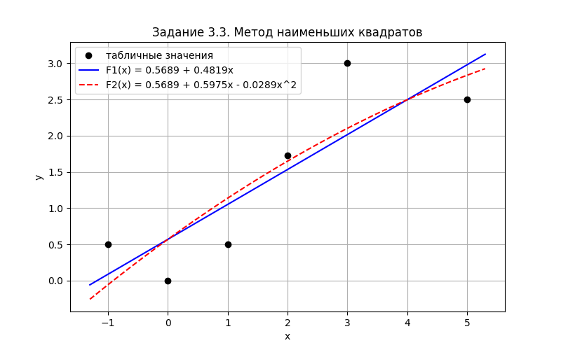

# Лабораторная работа №3. Методы приближения функций. Численное дифференцирование и интегрирование

Вариант 27

## Запуск

Из корня репозитория:

```
cmake -S . -B build -G Ninja -DCMAKE_CXX_COMPILER=g++
cmake --build build
./build/bin/lab3.exe
```

Пункты меню:

| Пункт | Задание | Файл с данными |
|---|---|---|
| 1 | 3.1 Интерполяционные многочлены Лагранжа и Ньютона | `data/lab3/input_3_1.txt` |
| 2 | 3.2 Кубический сплайн | `data/lab3/input_3_2.txt` |
| 3 | 3.3 Метод наименьших квадратов | `data/lab3/input_3_3.txt` |
| 4 | 3.4 Численное дифференцирование | `data/lab3/input_3_4.txt` |
| 5 | 3.5 Численное интегрирование | `data/lab3/input_3_5.txt` |

График к заданию 3.3 строит скрипт `plots.py` (нужны numpy и matplotlib):

```
python Lab3/plots.py
```

Картинка сохраняется в папку `Lab3/images`.

## Задание 3.1. Интерполяционные многочлены Лагранжа и Ньютона

### Условие
Используя таблицу значений $Y_i$ функции $y = f(x)$, вычисленных в точках $X_i$, $i = 0, \dots, 3$,
построить интерполяционные многочлены Лагранжа и Ньютона, проходящие через точки $\{X_i, Y_i\}$.
Вычислить значение погрешности интерполяции в точке $X^\ast$.

### Вариант 27

$$
y = x \sin(x), \qquad
\text{а) } X_i = 0, \frac{\pi}{6}, \frac{2\pi}{6}, \frac{3\pi}{6}; \qquad
\text{б) } X_i = 0, \frac{\pi}{6}, \frac{5\pi}{12}, \frac{\pi}{2}; \qquad
X^\ast = \frac{\pi}{4}
$$

### Решение
Узлов четыре, поэтому многочлены третьей степени.

**Многочлен Лагранжа** (3.6):

$$
L_3(x) = \sum_{i=0}^{3} f_i \frac{\omega_4(x)}{(x - x_i)\,\omega_4'(x_i)}, \qquad
\omega_4(x) = (x - x_0)(x - x_1)(x - x_2)(x - x_3)
$$

$\omega_4'(x_i)$ - произведение $(x_i - x_j)$ по всем $j \ne i$.

**Многочлен Ньютона** (3.8):

$$
P_3(x) = f(x_0) + (x - x_0) f(x_0, x_1) + (x - x_0)(x - x_1) f(x_0, x_1, x_2) + (x - x_0)(x - x_1)(x - x_2) f(x_0, x_1, x_2, x_3)
$$

Разделенные разности (3.7) считаются по таблице, как табл. 3.1 в методичке.

Через 4 точки проходит только один многочлен 3-й степени. Поэтому Лагранж и Ньютон - это один и тот же
многочлен, записанный по-разному, и значения в $X^\ast$ у них совпадают.

Погрешность считается как $|y(X^\ast) - L_3(X^\ast)|$. Для проверки ее можно сравнить с оценкой (3.9):

$$
|f(x) - L_3(x)| \le \frac{M_4}{4!} |\omega_4(x)|, \qquad M_4 = \max_{[x_0, x_3]} |f^{(4)}(x)|
$$

Для $f = x\sin x$ получается $f^{(4)}(x) = x\sin x - 4\cos x$. На $[0, \pi/2]$ эта функция возрастает
от $-4$ до $\pi/2$, поэтому $M_4 = 4$.

### Входные данные
`input_3_1.txt`: узлы для а), узлы для б) и точка $X^\ast$. Все числа записаны в долях $\pi$:
`5/12` означает $5\pi/12$. Так точнее, чем писать десятичные дроби.
```
0 1/6 2/6 3/6
0 1/6 5/12 1/2
1/4
```

### Что выводит программа
1. Таблицу $x_i, f_i, \omega_4'(x_i), f_i / \omega_4'(x_i), X^\ast - x_i$ и многочлен Лагранжа.
2. Таблицу разделенных разностей и многочлен Ньютона.
3. Значения $L_3(X^\ast)$, $P_3(X^\ast)$, точное значение и погрешность.
4. Оценку (3.9) и проверку, что погрешность ее не превышает.

### Результат
Точное значение $y(\pi/4) = \frac{\pi}{4}\sin\frac{\pi}{4} = 0.555360$.

| | $L_3(X^\ast) = P_3(X^\ast)$ | Погрешность | Оценка (3.9) |
|---|---|---|---|
| а) | 0.559218 | 0.003858 | 0.007046 |
| б) | 0.562287 | 0.006926 | 0.01409 |

а) $L_3(x) = 0.911891x(x - 1.0472)(x - 1.5708) - 3.15888x(x - 0.523599)(x - 1.5708) + 1.82378x(x - 0.523599)(x - 1.0472)$

$P_3(x) = 0.5x + 0.699057x(x - 0.523599) - 0.42321x(x - 0.523599)(x - 1.0472)$

б) $L_3(x) = 0.607927x(x - 1.309)(x - 1.5708) - 4.6977x(x - 0.523599)(x - 1.5708) + 3.64756x(x - 0.523599)(x - 1.309)$

$P_3(x) = 0.5x + 0.593235x(x - 0.523599) - 0.44221x(x - 0.523599)(x - 1.309)$

Слагаемое с $f_0$ в многочлене Лагранжа не пишется, потому что $f_0 = 0 \cdot \sin 0 = 0$.

В варианте б) погрешность больше примерно в 2 раза. В нем точка $X^\ast = \pi/4$ стоит дальше от узла
$5\pi/12$, поэтому $|\omega_4(X^\ast)|$ в 2 раза больше (0.0846 против 0.0423).

## Задание 3.2. Кубический сплайн

### Условие
Построить кубический сплайн для функции, заданной в узлах интерполяции, предполагая, что сплайн имеет
нулевую кривизну при $x = x_0$ и $x = x_4$. Вычислить значение функции в точке $x = X^\ast$.

### Вариант 27
$X^\ast = 1.5$

| i | 0 | 1 | 2 | 3 | 4 |
|---|---|---|---|---|---|
| $x_i$ | 0.0 | 1.0 | 2.0 | 3.0 | 5.0 |
| $f_i$ | 0.0 | 0.26180 | 0.90690 | 1.5708 | 1.3090 |

### Решение
На каждом отрезке $[x_{i-1}, x_i]$ сплайн задается многочленом (3.11):

$$
S(x) = a_i + b_i(x - x_{i-1}) + c_i(x - x_{i-1})^2 + d_i(x - x_{i-1})^3, \qquad i = 1, \dots, 4
$$

Нулевая кривизна на концах: $S''(x_0) = 2c_1 = 0$ и $S''(x_4) = 0$.
Коэффициенты $c_2, c_3, c_4$ находятся из трехдиагональной системы (3.13), где $h_i = x_i - x_{i-1}$.
Система решается методом прогонки из лабораторной 1.
Остальные коэффициенты считаются по формулам (3.14).

Сетка здесь неравномерная: последний шаг $h_4 = 2$, поэтому в последнем уравнении коэффициент при $c_4$
равен $2(h_3 + h_4) = 6$, а не 4.

### Входные данные
`input_3_2.txt`: точка $X^\ast$, узлы $x_i$, значения $f_i$.
```
1.5
0.0 1.0 2.0 3.0 5.0
0.0 0.26180 0.90690 1.5708 1.3090
```

### Что выводит программа
1. Систему (3.13) и ее решение $c_2, c_3, c_4$.
2. Таблицу коэффициентов $a_i, b_i, c_i, d_i$ и проверку условий (3.12): сплайн проходит через
   все точки, $S'$ и $S''$ непрерывны в узлах, на концах $S'' = 0$.
3. Многочлен на отрезке, где лежит $X^\ast$, и значение $f(X^\ast)$.

### Результат
Система (3.13):

$$
\begin{cases}
4c_2 + c_3 = 1.1499 \\
c_2 + 4c_3 + c_4 = 0.0564 \\
c_3 + 6c_4 = -2.3844
\end{cases}
$$

| i | $[x_{i-1}, x_i]$ | $a_i$ | $b_i$ | $c_i$ | $d_i$ |
|---|---|---|---|---|---|
| 1 | [0, 1] | 0 | 0.169843 | 0 | 0.091957 |
| 2 | [1, 2] | 0.2618 | 0.445714 | 0.275871 | -0.0764849 |
| 3 | [2, 3] | 0.9069 | 0.768001 | 0.0464163 | -0.150517 |
| 4 | [3, 5] | 1.5708 | 0.409281 | -0.405136 | 0.0675227 |

Точка $X^\ast = 1.5$ лежит на отрезке $[1, 2]$:

$$
f(x) = 0.2618 + 0.445714(x - 1) + 0.275871(x - 1)^2 - 0.0764849(x - 1)^3, \qquad f(1.5) = 0.544064
$$

## Задание 3.3. Метод наименьших квадратов

### Условие
Для таблично заданной функции путем решения нормальной системы МНК найти приближающие многочлены
а) 1-ой и б) 2-ой степени. Для каждого из приближающих многочленов вычислить сумму квадратов ошибок.
Построить графики приближаемой функции и приближающих многочленов.

### Вариант 27

| i | 0 | 1 | 2 | 3 | 4 | 5 |
|---|---|---|---|---|---|---|
| $x_i$ | -1.0 | 0.0 | 1.0 | 2.0 | 3.0 | 5.0 |
| $y_i$ | 0.5 | 0.0 | 0.5 | 1.7321 | 3.0 | 2.5 |

### Решение
Коэффициенты многочлена $F_n(x) = a_0 + a_1x + \dots + a_nx^n$ подбираются так, чтобы сумма квадратов
ошибок (3.15) была минимальной:

$$
\Phi = \sum_{j=0}^{N} \left[F_n(x_j) - y_j\right]^2
$$

Если приравнять к нулю производные $\partial\Phi / \partial a_k$, получится нормальная система (3.17):

$$
\sum_{i=0}^{n} a_i \sum_{j=0}^{N} x_j^{k+i} = \sum_{j=0}^{N} y_j x_j^k, \qquad k = 0, \dots, n
$$

Она решается методом Гаусса с выбором главного элемента.

### Входные данные
`input_3_3.txt`: строка $x_i$ и строка $y_i$.
```
-1.0 0.0 1.0 2.0 3.0 5.0
0.5 0.0 0.5 1.7321 3.0 2.5
```

### Что выводит программа
Для каждой степени: нормальную систему, ее решение, многочлен, таблицу $F(x_i)$ и
ошибок $F(x_i) - y_i$, сумму квадратов ошибок.

### Результат
а) Нормальная система и многочлен 1-й степени:

$$
\begin{cases}
6a_0 + 10a_1 = 8.2321 \\
10a_0 + 40a_1 = 24.9642
\end{cases}
\qquad F_1(x) = 0.568871 + 0.481887x, \qquad \Phi_1 = 2.03724
$$

б) Нормальная система и многочлен 2-й степени:

$$
\begin{cases}
6a_0 + 10a_1 + 40a_2 = 8.2321 \\
10a_0 + 40a_1 + 160a_2 = 24.9642 \\
40a_0 + 160a_1 + 724a_2 = 97.4284
\end{cases}
\qquad F_2(x) = 0.568871 + 0.597525x - 0.0289095x^2, \qquad \Phi_2 = 1.96703
$$

| i | 0 | 1 | 2 | 3 | 4 | 5 |
|---|---|---|---|---|---|---|
| $y_i$ | 0.5 | 0.0 | 0.5 | 1.7321 | 3.0 | 2.5 |
| $F_1(x_i)$ | 0.08698 | 0.56887 | 1.05076 | 1.53265 | 2.01453 | 2.97831 |
| $F_2(x_i)$ | -0.05756 | 0.56887 | 1.13749 | 1.64828 | 2.10126 | 2.83376 |



У многочлена 2-й степени сумма квадратов ошибок меньше, но ненамного. Так и должно быть:
многочлен 1-й степени - это частный случай 2-й степени с $a_2 = 0$, поэтому $\Phi_2 \le \Phi_1$ всегда.

## Задание 3.4. Численное дифференцирование

### Условие
Вычислить первую и вторую производную от таблично заданной функции $y_i = f(x_i)$, $i = 0, 1, 2, 3, 4$
в точке $x = X^\ast$.

### Вариант 27
$X^\ast = 0.0$

| i | 0 | 1 | 2 | 3 | 4 |
|---|---|---|---|---|---|
| $x_i$ | -1.0 | -0.5 | 0.0 | 0.5 | 1.0 |
| $y_i$ | -0.36788 | -0.30327 | 0.0 | 0.82436 | 2.7183 |

### Решение
$X^\ast = 0$ совпадает с узлом $x_2$. Как в примере из методички, берем отрезок $[x_1, x_2]$, для которого
$X^\ast$ - правый конец.

- Формула (3.18), первый порядок точности: левосторонняя производная по отрезку $[x_1, x_2]$
  и правосторонняя по $[x_2, x_3]$.
- Формула (3.20), второй порядок точности: производная многочлена 2-й степени по точкам $x_1, x_2, x_3$:

$$
y'(X^\ast) = \frac{y_2 - y_1}{x_2 - x_1} + \frac{\dfrac{y_3 - y_2}{x_3 - x_2} - \dfrac{y_2 - y_1}{x_2 - x_1}}{x_3 - x_1}(2X^\ast - x_1 - x_2)
$$

- Формула (3.21), вторая производная:

$$
y''(X^\ast) = 2\,\frac{\dfrac{y_3 - y_2}{x_3 - x_2} - \dfrac{y_2 - y_1}{x_2 - x_1}}{x_3 - x_1}
$$

### Входные данные
`input_3_4.txt`: точка $X^\ast$, строка $x_i$, строка $y_i$.
```
0.0
-1.0 -0.5 0.0 0.5 1.0
-0.36788 -0.30327 0.0 0.82436 2.7183
```

### Результат

| | Значение |
|---|---|
| $y'(0)$ левосторонняя (3.18) | 0.60654 |
| $y'(0)$ правосторонняя (3.18) | 1.64872 |
| $y'(0)$ второго порядка (3.20) | 1.12763 |
| $y''(0)$ (3.21) | 2.08436 |

Сетка равномерная, поэтому (3.20) совпадает с полусуммой левой и правой производных:
$(0.60654 + 1.64872) / 2 = 1.12763$.

Для проверки: значения в таблице совпадают с функцией $y = xe^x$. Для нее
$y' = (1 + x)e^x$ и $y'' = (2 + x)e^x$, то есть $y'(0) = 1$ и $y''(0) = 2$.
Формула второго порядка дает $y'$ намного точнее (ошибка 0.128), чем односторонние (ошибки 0.39 и 0.65).

## Задание 3.5. Численное интегрирование

### Условие
Вычислить определенный интеграл $F = \int_{X_0}^{X_1} y\,dx$ методами прямоугольников, трапеций, Симпсона
с шагами $h_1, h_2$. Оценить погрешность вычислений, используя метод Рунге-Ромберга.

### Вариант 27

$$
y = \sqrt{9 + x^2}, \qquad X_0 = 1, \quad X_k = 5, \quad h_1 = 1.0, \quad h_2 = 0.5
$$

### Решение
Формулы с постоянным шагом h, $x_i = X_0 + ih$:
- прямоугольников (3.23): $F = h\left[y\left(\frac{x_0 + x_1}{2}\right) + \dots + y\left(\frac{x_{N-1} + x_N}{2}\right)\right]$;
- трапеций (3.25): $F = h\left[\frac{y_0}{2} + y_1 + \dots + y_{N-1} + \frac{y_N}{2}\right]$;
- Симпсона (3.28): $F = \frac{h}{3}\left[y_0 + 4y_1 + 2y_2 + 4y_3 + \dots + 4y_{N-1} + y_N\right]$, N четное.

Метод Рунге-Ромберга (3.30). Пусть $F_h$ посчитан с шагом $h = h_2$, а $F_{kh}$ с шагом $kh = h_1$,
тогда $k = 2$ и

$$
F \approx F_h + \frac{F_h - F_{kh}}{k^p - 1}
$$

Добавка $R = \frac{F_h - F_{kh}}{k^p - 1}$ - это оценка погрешности $F_h$. Порядок точности p = 2
у прямоугольников и трапеций и p = 4 у Симпсона.

Точное значение для сравнения:

$$
\int \sqrt{9 + x^2}\,dx = \frac{x}{2}\sqrt{9 + x^2} + \frac{9}{2}\ln\left(x + \sqrt{9 + x^2}\right), \qquad F = 17.299796
$$

### Входные данные
`input_3_5.txt`: пределы $X_0, X_k$ и шаги $h_1, h_2$.
```
1 5
1.0 0.5
```

### Что выводит программа
1. Для каждого шага: таблицу $x_i, y_i$ и значения интеграла от $X_0$ до $x_i$ всеми методами,
   в таком же виде, как в методичке.
2. Для каждого метода: значения с шагами $h_1$ и $h_2$, оценку R, уточненное значение и
   отличие от точного значения.

### Результат

| Метод | $h_1 = 1$ | $h_2 = 0.5$ | R | Уточненное | Ошибка $F_{h_2}$ | Ошибка уточненного |
|---|---|---|---|---|---|---|
| Прямоугольников | 17.277326 | 17.294163 | 0.005612 | 17.299775 | 0.00563 | 2.1e-05 |
| Трапеций | 17.344807 | 17.311066 | -0.01125 | 17.299820 | 0.0113 | 2.38e-05 |
| Симпсона | 17.300239 | 17.299820 | -2.794e-05 | 17.299792 | 2.38e-05 | 4.11e-06 |

Оценка R почти совпадает с настоящей погрешностью $F - F_{h_2}$. Например, у прямоугольников
$R = 0.005612$, а на самом деле $17.299796 - 17.294163 = 0.005633$. Значит, метод Рунге-Ромберга хорошо
оценивает погрешность, когда точное значение неизвестно.

При уменьшении шага в 2 раза погрешность у прямоугольников и трапеций уменьшается в 4 раза,
у Симпсона в 18.6 раза (по теории в $2^4 = 16$). Это соответствует порядкам p = 2 и p = 4.
Ошибка прямоугольников примерно вдвое меньше, чем у трапеций, и с другим знаком.

Уточненное значение для трапеций совпало со значением Симпсона с шагом $h_2$. Так и должно быть:
$F_h + \frac{F_h - F_{2h}}{3} = \frac{4F_h - F_{2h}}{3}$, а это и есть формула Симпсона.
